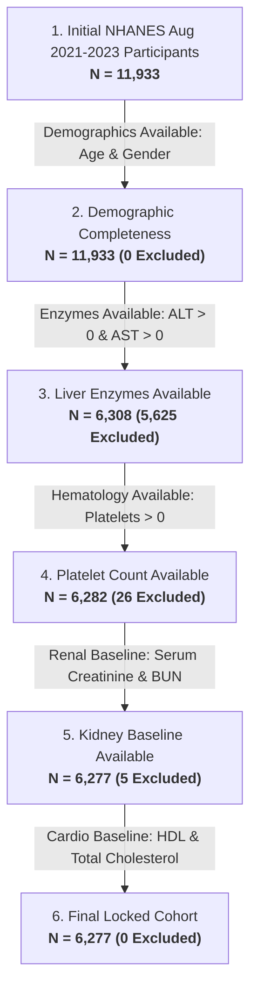

# Dataset Provenance, NHANES Source Modules, and Cohort Derivation

**Document Type**: Authoritative Technical Specification  
**Cohort Key**: NHANES Cycle August 2021 to August 2023 (CDC Public Release)  
**Total Raw Survey Participants**: 11,933 Unique Individuals (Keyed by `SEQN`)  
**Final Locked Analytic Cohort**: $N = 6,277$ Participants  
**Preservation Status**: `VERIFIED-ON-DISK` | `backups/baseline_v1/data/final_cohort.csv`  

---

## 1. Primary Data Source & Integration Architecture

The dataset is derived entirely from the **National Health and Nutrition Examination Survey (NHANES) August 2021 to August 2023 cycle**, published by the National Center for Health Statistics (NCHS) at the Centers for Disease Control and Prevention (CDC).

The raw data consists of **27 SAS Transport (`.xpt`) files** distributed across 4 official CDC survey modules:
- **Demographics (`DEMO G`)**: 1 file
- **Examination (`EXAMINATION`)**: 3 files
- **Laboratory (`LABORATORY`)**: 14 files
- **Questionnaire (`QUESTIONNAIRE`)**: 9 files

All files are joined on the patient respondent sequence number (`SEQN`) via sequential outer joins implemented in [`src/dataset.py`](file:///c:/Users/admin_fix/Downloads/3%20ORGAN/src/dataset.py#L54-L122). Every file has been verified to contain 100% unique `SEQN` identifiers (zero duplicate rows).

---

## 2. Ingestion Manifest: All 27 NHANES XPT Source Files

The following table records all 27 ingested NHANES files, their categories, raw participant counts, unique `SEQN` verification, and column dimensions:

| File Key | CDC Survey Module | Official File Description | Raw Rows | Unique `SEQN` | SEQN Unique? | Variables | Local Repository Path |
| :--- | :--- | :--- | :---: | :---: | :---: | :---: | :--- |
| `DEMO_L` | DEMO G | Demographic Variables & Sample Weights | 11,933 | 11,933 | **True** | 27 | [`NHANES AUG'21 - AUG'23/DEMO G/DEMO_L.xpt`](file:///c:/Users/admin_fix/Downloads/3%20ORGAN/NHANES%20AUG'21%20-%20AUG'23/DEMO%20G/DEMO_L.xpt) |
| `BIOPRO_L` | LABORATORY | Standard Biochemistry Profile | 7,199 | 7,199 | **True** | 42 | [`NHANES AUG'21 - AUG'23/LABORATORY/BIOPRO_L.xpt`](file:///c:/Users/admin_fix/Downloads/3%20ORGAN/NHANES%20AUG'21%20-%20AUG'23/LABORATORY/BIOPRO_L.xpt) |
| `CBC_L` | LABORATORY | Complete Blood Count with 5-Part Differential | 8,727 | 8,727 | **True** | 23 | [`NHANES AUG'21 - AUG'23/LABORATORY/CBC_L.xpt`](file:///c:/Users/admin_fix/Downloads/3%20ORGAN/NHANES%20AUG'21%20-%20AUG'23/LABORATORY/CBC_L.xpt) |
| `ALB_CR_L` | LABORATORY | Albumin & Creatinine - Urine | 8,493 | 8,493 | **True** | 8 | [`NHANES AUG'21 - AUG'23/LABORATORY/ALB_CR_L.xpt`](file:///c:/Users/admin_fix/Downloads/3%20ORGAN/NHANES%20AUG'21%20-%20AUG'23/LABORATORY/ALB_CR_L.xpt) |
| `HDL_L` | LABORATORY | Cholesterol - High-Density Lipoprotein (HDL) | 8,068 | 8,068 | **True** | 4 | [`NHANES AUG'21 - AUG'23/LABORATORY/HDL_L.xpt`](file:///c:/Users/admin_fix/Downloads/3%20ORGAN/NHANES%20AUG'21%20-%20AUG'23/LABORATORY/HDL_L.xpt) |
| `TRIGLY_L` | LABORATORY | Cholesterol - Low-Density Lipoprotein & Triglycerides | 3,996 | 3,996 | **True** | 10 | [`NHANES AUG'21 - AUG'23/LABORATORY/TRIGLY_L.xpt`](file:///c:/Users/admin_fix/Downloads/3%20ORGAN/NHANES%20AUG'21%20-%20AUG'23/LABORATORY/TRIGLY_L.xpt) |
| `TCHOL_L` | LABORATORY | Total Cholesterol | 8,068 | 8,068 | **True** | 4 | [`NHANES AUG'21 - AUG'23/LABORATORY/TCHOL_L.xpt`](file:///c:/Users/admin_fix/Downloads/3%20ORGAN/NHANES%20AUG'21%20-%20AUG'23/LABORATORY/TCHOL_L.xpt) |
| `HSCRP_L` | LABORATORY | High-Sensitivity C-Reactive Protein (hs-CRP) | 8,727 | 8,727 | **True** | 4 | [`NHANES AUG'21 - AUG'23/LABORATORY/HSCRP_L.xpt`](file:///c:/Users/admin_fix/Downloads/3%20ORGAN/NHANES%20AUG'21%20-%20AUG'23/LABORATORY/HSCRP_L.xpt) |
| `GLU_L` | LABORATORY | Fasting Plasma Glucose | 3,996 | 3,996 | **True** | 4 | [`NHANES AUG'21 - AUG'23/LABORATORY/GLU_L.xpt`](file:///c:/Users/admin_fix/Downloads/3%20ORGAN/NHANES%20AUG'21%20-%20AUG'23/LABORATORY/GLU_L.xpt) |
| `INS_L` | LABORATORY | Fasting Serum Insulin | 3,996 | 3,996 | **True** | 5 | [`NHANES AUG'21 - AUG'23/LABORATORY/INS_L.xpt`](file:///c:/Users/admin_fix/Downloads/3%20ORGAN/NHANES%20AUG'21%20-%20AUG'23/LABORATORY/INS_L.xpt) |
| `GHB_L` | LABORATORY | Glycohemoglobin (HbA1c) | 7,199 | 7,199 | **True** | 3 | [`NHANES AUG'21 - AUG'23/LABORATORY/GHB_L.xpt`](file:///c:/Users/admin_fix/Downloads/3%20ORGAN/NHANES%20AUG'21%20-%20AUG'23/LABORATORY/GHB_L.xpt) |
| `HEPA_L` | LABORATORY | Hepatitis A Antibody | 8,611 | 8,611 | **True** | 3 | [`NHANES AUG'21 - AUG'23/LABORATORY/HEPA_L.xpt`](file:///c:/Users/admin_fix/Downloads/3%20ORGAN/NHANES%20AUG'21%20-%20AUG'23/LABORATORY/HEPA_L.xpt) |
| `HEPBD_L` | LABORATORY | Hepatitis B Surface & Core Antibodies | 8,068 | 8,068 | **True** | 5 | [`NHANES AUG'21 - AUG'23/LABORATORY/HEPBD_L.xpt`](file:///c:/Users/admin_fix/Downloads/3%20ORGAN/NHANES%20AUG'21%20-%20AUG'23/LABORATORY/HEPBD_L.xpt) |
| `HEPC_L` | LABORATORY | Hepatitis C Antibody & Confirmatory RNA | 8,068 | 8,068 | **True** | 5 | [`NHANES AUG'21 - AUG'23/LABORATORY/HEPC_L.xpt`](file:///c:/Users/admin_fix/Downloads/3%20ORGAN/NHANES%20AUG'21%20-%20AUG'23/LABORATORY/HEPC_L.xpt) |
| `HEPE_L` | LABORATORY | Hepatitis E IgG & IgM Antibodies | 8,068 | 8,068 | **True** | 4 | [`NHANES AUG'21 - AUG'23/LABORATORY/HEPE_L.xpt`](file:///c:/Users/admin_fix/Downloads/3%20ORGAN/NHANES%20AUG'21%20-%20AUG'23/LABORATORY/HEPE_L.xpt) |
| `BMX_L` | EXAMINATION | Body Measures (Height, Weight, BMI) | 8,860 | 8,860 | **True** | 22 | [`NHANES AUG'21 - AUG'23/EXAMINATION/BMX_L.xpt`](file:///c:/Users/admin_fix/Downloads/3%20ORGAN/NHANES%20AUG'21%20-%20AUG'23/EXAMINATION/BMX_L.xpt) |
| `BPXO_L` | EXAMINATION | Blood Pressure - Oscillometric Automated | 7,801 | 7,801 | **True** | 12 | [`NHANES AUG'21 - AUG'23/EXAMINATION/BPXO_L.xpt`](file:///c:/Users/admin_fix/Downloads/3%20ORGAN/NHANES%20AUG'21%20-%20AUG'23/EXAMINATION/BPXO_L.xpt) |
| `LUX_L` | EXAMINATION | Liver Ultrasound Transient Elastography (FibroScan) | 7,199 | 7,199 | **True** | 13 | [`NHANES AUG'21 - AUG'23/EXAMINATION/LUX_L.xpt`](file:///c:/Users/admin_fix/Downloads/3%20ORGAN/NHANES%20AUG'21%20-%20AUG'23/EXAMINATION/LUX_L.xpt) |
| `BPQ_L` | QUESTIONNAIRE | Blood Pressure & Cholesterol Questionnaire | 8,501 | 8,501 | **True** | 6 | [`NHANES AUG'21 - AUG'23/QUESTIONNAIRE/BPQ_L.xpt`](file:///c:/Users/admin_fix/Downloads/3%20ORGAN/NHANES%20AUG'21%20-%20AUG'23/QUESTIONNAIRE/BPQ_L.xpt) |
| `KIQ_U_L` | QUESTIONNAIRE | Kidney Conditions Questionnaire | 7,809 | 7,809 | **True** | 9 | [`NHANES AUG'21 - AUG'23/QUESTIONNAIRE/KIQ_U_L.xpt`](file:///c:/Users/admin_fix/Downloads/3%20ORGAN/NHANES%20AUG'21%20-%20AUG'23/QUESTIONNAIRE/KIQ_U_L.xpt) |
| `MCQ_L` | QUESTIONNAIRE | Medical Conditions Questionnaire | 11,744 | 11,744 | **True** | 35 | [`NHANES AUG'21 - AUG'23/QUESTIONNAIRE/MCQ_L.xpt`](file:///c:/Users/admin_fix/Downloads/3%20ORGAN/NHANES%20AUG'21%20-%20AUG'23/QUESTIONNAIRE/MCQ_L.xpt) |
| `DIQ_L` | QUESTIONNAIRE | Diabetes Questionnaire | 11,744 | 11,744 | **True** | 9 | [`NHANES AUG'21 - AUG'23/QUESTIONNAIRE/DIQ_L.xpt`](file:///c:/Users/admin_fix/Downloads/3%20ORGAN/NHANES%20AUG'21%20-%20AUG'23/QUESTIONNAIRE/DIQ_L.xpt) |
| `HEQ_L` | QUESTIONNAIRE | Hepatitis Questionnaire | 10,696 | 10,696 | **True** | 2 | [`NHANES AUG'21 - AUG'23/QUESTIONNAIRE/HEQ_L.xpt`](file:///c:/Users/admin_fix/Downloads/3%20ORGAN/NHANES%20AUG'21%20-%20AUG'23/QUESTIONNAIRE/HEQ_L.xpt) |
| `FNQ_L` | QUESTIONNAIRE | Physical Functioning Questionnaire | 10,942 | 10,942 | **True** | 32 | [`NHANES AUG'21 - AUG'23/QUESTIONNAIRE/FNQ_L.xpt`](file:///c:/Users/admin_fix/Downloads/3%20ORGAN/NHANES%20AUG'21%20-%20AUG'23/QUESTIONNAIRE/FNQ_L.xpt) |
| `DPQ_L` | QUESTIONNAIRE | Depression Screener (PHQ-9) | 6,337 | 6,337 | **True** | 11 | [`NHANES AUG'21 - AUG'23/QUESTIONNAIRE/DPQ_L.xpt`](file:///c:/Users/admin_fix/Downloads/3%20ORGAN/NHANES%20AUG'21%20-%20AUG'23/QUESTIONNAIRE/DPQ_L.xpt) |
| `SLQ_L` | QUESTIONNAIRE | Sleep Disorders Questionnaire | 8,501 | 8,501 | **True** | 7 | [`NHANES AUG'21 - AUG'23/QUESTIONNAIRE/SLQ_L.xpt`](file:///c:/Users/admin_fix/Downloads/3%20ORGAN/NHANES%20AUG'21%20-%20AUG'23/QUESTIONNAIRE/SLQ_L.xpt) |
| `DBQ_L` | QUESTIONNAIRE | Diet Behavior & Nutrition Questionnaire | 11,933 | 11,933 | **True** | 27 | [`NHANES AUG'21 - AUG'23/QUESTIONNAIRE/DBQ_L.xpt`](file:///c:/Users/admin_fix/Downloads/3%20ORGAN/NHANES%20AUG'21%20-%20AUG'23/QUESTIONNAIRE/DBQ_L.xpt) |

*Source Reference*: [`data/ingestion_summary.csv`](file:///c:/Users/admin_fix/Downloads/3%20ORGAN/data/ingestion_summary.csv#L1-L28)

---

## 3. Master Patient Table Generation

The sequential outer-join across all 27 files creates the master patient table:
- **Output File**: [`data/master_patient.csv`](file:///c:/Users/admin_fix/Downloads/3%20ORGAN/data/master_patient.csv)
- **Total Patients**: 11,933 unique individuals
- **Total Combined Columns**: 361 variables
- **Primary Joining Key**: `SEQN` (Respondent Sequence Number)

---

## 4. Sequential Inclusion/Exclusion Filtering (Cohort Flow)

To ensure that every patient in the final benchmark has complete, non-zero biological components to compute the ground-truth FIB-4 target, as well as core renal and cardiovascular baseline laboratory markers, 6 sequential filtering steps are executed by [`src/cohort.py`](file:///c:/Users/admin_fix/Downloads/3%20ORGAN/src/cohort.py#L9-L76):

### Audited Cohort Flow Table

| Step | Sequential Inclusion Filter | Inclusion Rule | $N$ Remaining | $N$ Excluded | Rationale |
| :---: | :--- | :--- | :---: | :---: | :--- |
| **1** | Initial Participants | Full NHANES 2021–2023 Survey | **11,933** | 0 | Unfiltered CDC respondent baseline. |
| **2** | Demographics Availability | `RIDAGEYR` & `RIAGENDR` complete | **11,933** | 0 | Baseline demographic covariates. |
| **3** | Liver Enzymes Availability | `LBXSATSI` > 0 and `LBXSASSI` > 0 | **6,308** | 5,625 | Required for FIB-4 calculation; non-positive enzymes physiologically invalid. |
| **4** | Platelet Count Availability | `LBXPLTSI` > 0 | **6,282** | 26 | Required for FIB-4 calculation; non-positive platelets mathematically invalid. |
| **5** | Kidney Baseline Availability | `LBXSCR` & `LBXSBU` complete | **6,277** | 5 | Establishes core baseline multi-organ renal function (Creatinine and BUN). |
| **6** | Cardiovascular Baseline | `LBDHDD` & `LBXTC` complete | **6,277** | 0 | Establishes baseline lipid profile (HDL and Total Cholesterol). |

*Source Reference*: [`data/cohort_flow.csv`](file:///c:/Users/admin_fix/Downloads/3%20ORGAN/data/cohort_flow.csv#L1-L7)

### Final Cohort Identifiers and Structure
- **Patient Identifier Generation**: Each patient receives a deterministic identifier: `patient_uid` = `P_000001` to `P_006277`.
- **Output Storage**: [`data/final_cohort.csv`](file:///c:/Users/admin_fix/Downloads/3%20ORGAN/data/final_cohort.csv) ($N=6,277$ rows, 362 columns).
- **Preserved Snapshot**: [`backups/baseline_v1/data/final_cohort.csv`](file:///c:/Users/admin_fix/Downloads/3%20ORGAN/backups/baseline_v1/data/final_cohort.csv) (SHA-256: `7d9f30deb21b4c49683b96a62d6866fedd8877f3c60b8c03d208f699c6c5ca1f`, 100% matched).
