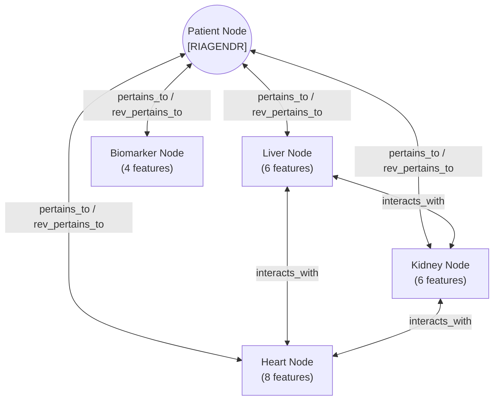

# Heterogeneous Systemic Graph Interaction Network (HSGIN) Architecture & Implementation

**Implementation Script**: [`src/models/hsgin.py`](file:///c:/Users/admin_fix/Downloads/3%20ORGAN/src/models/hsgin.py)  
**Graph Construction Script**: [`src/graph_builder.py`](file:///c:/Users/admin_fix/Downloads/3%20ORGAN/src/graph_builder.py)  
**Serialized Graph Cache**: [`graphs/patient_graphs.pt`](file:///c:/Users/admin_fix/Downloads/3%20ORGAN/graphs/patient_graphs.pt) (Size: 19,393,163 bytes; $N=6,277$ graphs)  
**Verification Standard**: 100% Agreement Between Graph Builder Code, Model Architecture, and Serialized Cache  
**Status**: `VERIFIED-ON-DISK`  

---

## 1. Graph Topology Specification

Each individual patient in the cohort is modeled as an independent heterogeneous graph (`torch_geometric.data.HeteroData`). The graph topology models physiological multi-organ interactions across three major organ axes (Hepatic, Renal, Cardiovascular) plus systemic hematology and demographic covariates.

### 1.1 The 5 Heterogeneous Node Types

| Node Key | Biological Domain | Feature Dimensionality | Features Assigned | Biological Interpretation |
| :--- | :--- | :---: | :--- | :--- |
| `'patient'` | Demographics | 1 | `RIAGENDR` (Biological Sex) | Central patient anchor node |
| `'liver'` | Hepatic Axis | 6 | `LBXSGTSI`, `LBXSAL`, `LBXSTB`, `LBXSAPSI`, `LUXSMED`, `LUXCAPM` | Hepatic biochemistry & elastography |
| `'kidney'` | Renal Axis | 6 | `LBXSCR`, `LBXSBU`, `LBXSUA`, `URXUMA`, `URXUCR`, `KIQ022` | Renal filtration & clinical history |
| `'heart'` | Cardiovascular Axis | 8 | `BPXOSY1`, `BPXODI1`, `BPXOPLS1`, `LBDHDD`, `LBXTC`, `BPQ020`, `MCQ160C`, `MCQ160E` | Blood pressure, lipids & vascular history |
| `'biomarker'` | Systemic Hematology | 4 | `LBXWBCSI`, `LBXRBCSI`, `LBXHGB`, `LBXHSCRP` | Circulating blood counts & inflammation |
| **Total** | **5 Nodes** | **25 Features** | — | **Sum equals exactly 25 locked features** |

*Code Verification*: [`src/graph_builder.py`](file:///c:/Users/admin_fix/Downloads/3%20ORGAN/src/graph_builder.py#L28-L51)

---

### 1.2 The 14 Directed Edge Types

The graph structure comprises **14 directed relation types**, divided into bipartite patient-organ links and inter-organ systemic cross-talk:



#### Detailed Edge Registry

| # | Source Node | Relation Name (`rel`) | Destination Node | Edge Type Classification | Edge Tensor Index in Code |
| :---: | :--- | :--- | :--- | :--- | :---: |
| 1 | `patient` | `pertains_to` | `liver` | Bipartite (Patient $\to$ Organ) | `[[0], [0]]` |
| 2 | `liver` | `rev_pertains_to` | `patient` | Bipartite (Organ $\to$ Patient) | `[[0], [0]]` |
| 3 | `patient` | `pertains_to` | `kidney` | Bipartite (Patient $\to$ Organ) | `[[0], [0]]` |
| 4 | `kidney` | `rev_pertains_to` | `patient` | Bipartite (Organ $\to$ Patient) | `[[0], [0]]` |
| 5 | `patient` | `pertains_to` | `heart` | Bipartite (Patient $\to$ Organ) | `[[0], [0]]` |
| 6 | `heart` | `rev_pertains_to` | `patient` | Bipartite (Organ $\to$ Patient) | `[[0], [0]]` |
| 7 | `patient` | `pertains_to` | `biomarker` | Bipartite (Patient $\to$ Systemic) | `[[0], [0]]` |
| 8 | `biomarker` | `rev_pertains_to` | `patient` | Bipartite (Systemic $\to$ Patient) | `[[0], [0]]` |
| 9 | `liver` | `interacts_with` | `kidney` | Inter-Organ (Hepatorenal Axis) | `[[0], [0]]` |
| 10 | `kidney` | `interacts_with` | `liver` | Inter-Organ (Renal-Hepatic Feedback) | `[[0], [0]]` |
| 11 | `liver` | `interacts_with` | `heart` | Inter-Organ (Cardiohepatic Axis) | `[[0], [0]]` |
| 12 | `heart` | `interacts_with` | `liver` | Inter-Organ (Hepatic Venous Congestion) | `[[0], [0]]` |
| 13 | `kidney` | `interacts_with` | `heart` | Inter-Organ (Cardiorenal Syndrome) | `[[0], [0]]` |
| 14 | `heart` | `interacts_with` | `kidney` | Inter-Organ (Renal Perfusion) | `[[0], [0]]` |

*Structural Rule*: The `biomarker` node connects exclusively to the `patient` node (edges 7 & 8) and has **no direct edges** to individual organs. This reflects the biological reality that circulating inflammatory and hematologic markers represent systemic milieu rather than discrete anatomical structures.

*Code Verification*: [`src/graph_builder.py`](file:///c:/Users/admin_fix/Downloads/3%20ORGAN/src/graph_builder.py#L52-L75)

---

## 2. HSGIN Deep Architecture Implementation

The HSGIN model consists of four sequential computational stages implemented in PyTorch and PyTorch Geometric:

```
  [Raw Patient Features] (5 nodes, 25 dims)
           │
           ▼
  [1. Node Type Feature Encoders] (Linear + LayerNorm + ReLU + Dropout) ──> Hidden Dim H = 64
           │
           ▼
  [2. Heterogeneous Message Passing] (2 x HeteroOrganConvBlock with GATConv, 2 heads, residual)
           │
           ▼
  [3. Organ-Aware Hierarchical Readout] [h_patient (H) || h_organ_pool (H) || h_biomarker (H)] ──> Dim 3H = 192
           │
           ▼
  [4. Prediction MLP Head] (Linear 192->64 + LayerNorm + ReLU + Linear 64->32 + Linear 32->1)
           │
           ▼
     Continuous FIB-4 Prediction y_hat
```

### Stage 1: Initial Feature Encoders
Because each node type has a distinct feature dimension ($d_{\text{patient}}=1, d_{\text{liver}}=6, d_{\text{kidney}}=6, d_{\text{heart}}=8, d_{\text{biomarker}}=4$), distinct linear projection heads map each node into a common latent embedding space of dimension $H = 64$:

$$h_v^{(0)} = \text{Dropout}\left(\text{ReLU}\left(\text{LayerNorm}\left(W_{\tau(v)} x_v + b_{\tau(v)}\right)\right)\right), \quad \forall v \in \mathcal{V}_{\tau}$$

*Code*: [`src/models/hsgin.py`](file:///c:/Users/admin_fix/Downloads/3%20ORGAN/src/models/hsgin.py#L56-L63)

### Stage 2: Heterogeneous Message Passing (`HeteroOrganConvBlock`)
Message passing is performed using `pyg_nn.HeteroConv` aggregating across the 14 edge types. Within each edge type, a Graph Attention Network layer (`GATConv`) computes dynamic attention weights between interacting organ nodes:

$$\alpha_{i,j}^{(r)} = \frac{\exp\left(\text{LeakyReLU}\left(a_r^T [h_i \,\|\, h_j]\right)\right)}{\sum_{k \in \mathcal{N}_r(i)} \exp\left(\text{LeakyReLU}\left(a_r^T [h_i \,\|\, h_k]\right)\right)}$$

- **Attention Heads**: $K = 2$ heads.
- **Output Dimension per Head**: $H / K = 64 / 2 = 32$.
- **Concatenation**: Outputs from all heads are concatenated back to dimension $H = 64$.
- **Critical PyG Fix (`add_self_loops=False`)**: Bipartite edges between node types with different source and destination spaces cannot support identity self-loops without dimensionality errors. Self-loops are disabled (`add_self_loops=False`), and identity information is instead preserved via explicit residual connections.
- **Residual Connection**:
  $$h_v^{(l+1)} = \text{ReLU}\left(h_v^{(l)} + \text{HeteroConv}\left(h^{(l)}, \mathcal{E}\right)_v\right)$$
- **Number of Layers**: $L = 2$ message passing blocks.

*Code*: [`src/models/hsgin.py`](file:///c:/Users/admin_fix/Downloads/3%20ORGAN/src/models/hsgin.py#L6-L43, #L94-L99)

### Stage 3: Organ-Aware Hierarchical Readout Layer
Standard GNNs typically use flat mean pooling across all nodes or extract only the central anchor node. HSGIN implements an **organ-aware hierarchical readout** that explicitly preserves organ specialization:
1. Patient Anchor Vector: $h_{\text{patient}} \in \mathbb{R}^H$
2. Systemic Biomarker Vector: $h_{\text{biomarker}} \in \mathbb{R}^H$
3. Target Organ Pool (Mean across active visceral organ nodes):
   $$h_{\text{organ\_pool}} = \frac{1}{3} \left(h_{\text{liver}} + h_{\text{kidney}} + h_{\text{heart}}\right) \in \mathbb{R}^H$$
4. Readout Concatenation:
   $$h_{\text{repr}} = \left[ h_{\text{patient}} \,\|\, h_{\text{organ\_pool}} \,\|\, h_{\text{biomarker}} \right] \in \mathbb{R}^{3H} = \mathbb{R}^{192}$$

*Code*: [`src/models/hsgin.py`](file:///c:/Users/admin_fix/Downloads/3%20ORGAN/src/models/hsgin.py#L101-L117)

### Stage 4: Prediction MLP Regression Head
The fused $192$-dimensional multi-organ representation passes through a 3-layer MLP to predict the continuous FIB-4 score:

$$\hat{y} = W_3 \cdot \text{ReLU}\left(W_2 \cdot \text{Dropout}\left(\text{ReLU}\left(\text{LayerNorm}\left(W_1 h_{\text{repr}} + b_1\right)\right)\right) + b_2\right) + b_3$$

- Layer 1: $\mathbb{R}^{192} \to \mathbb{R}^{64}$ + LayerNorm + ReLU + Dropout($0.1$ or $0.2$)
- Layer 2: $\mathbb{R}^{64} \to \mathbb{R}^{32}$ + ReLU
- Layer 3: $\mathbb{R}^{32} \to \mathbb{R}^{1}$

*Code*: [`src/models/hsgin.py`](file:///c:/Users/admin_fix/Downloads/3%20ORGAN/src/models/hsgin.py#L74-L82)

---

## 3. Structural Comparison: HSGIN vs. Classical HGNN Baseline

[`src/models/baselines.py`](file:///c:/Users/admin_fix/Downloads/3%20ORGAN/src/models/baselines.py#L42-L84) defines `ClassicalHGNN` as the primary graph competitor to evaluate whether HSGIN's architectural innovations provide empirical benefit:

| Architectural Component | HSGIN (`src/models/hsgin.py`) | Classical HGNN (`src/models/baselines.py`) | Impact of Architectural Innovation |
| :--- | :--- | :--- | :--- |
| **Convolution Operator** | `pyg_nn.GATConv` (Attention-weighted) | `pyg_nn.SAGEConv` (Unweighted mean) | HSGIN dynamically attends to high-salience organ connections |
| **Attention Mechanism** | Multi-head ($K=2$) attention | None | Captures asymmetric cross-talk importance |
| **Residual Skips** | Explicit residual add ($h + \text{conv}(h)$) | None (Standard feed-forward) | Prevents over-smoothing across message passing |
| **Readout Structure** | **Hierarchical Organ-Aware** ($[h_P \| h_{\text{org}} \| h_B]$) | **Patient Node Only** ($h_P$) | HSGIN preserves direct organ embeddings; HGNN bottlenecks through patient node |
| **Readout Dimensionality**| $3 \times H = 192$ dimensions | $1 \times H = 64$ dimensions | 3x richer representation entering prediction head |
| **Empirical $R^2$ (Pooled)**| **0.5114** (Ensemble) / **0.4988** (Seed 42) | **0.4771** (Ensemble) / **0.4680** (Seed 42) | **HSGIN Superior: $\Delta R^2 = +0.0343$ ($p = 0.0028$)** |
